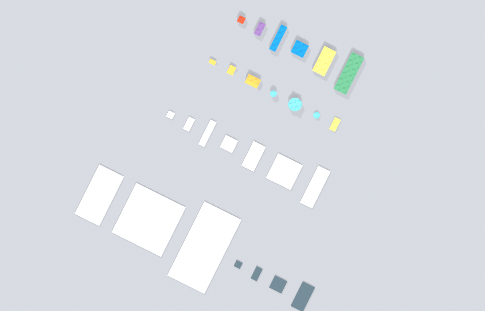
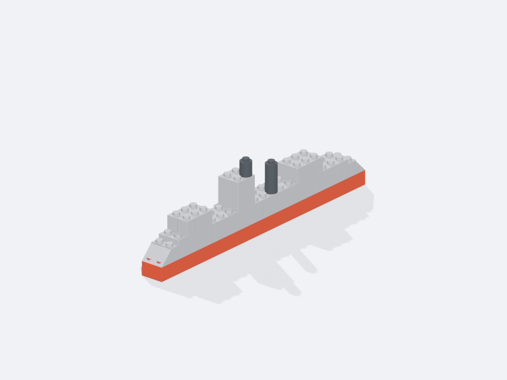
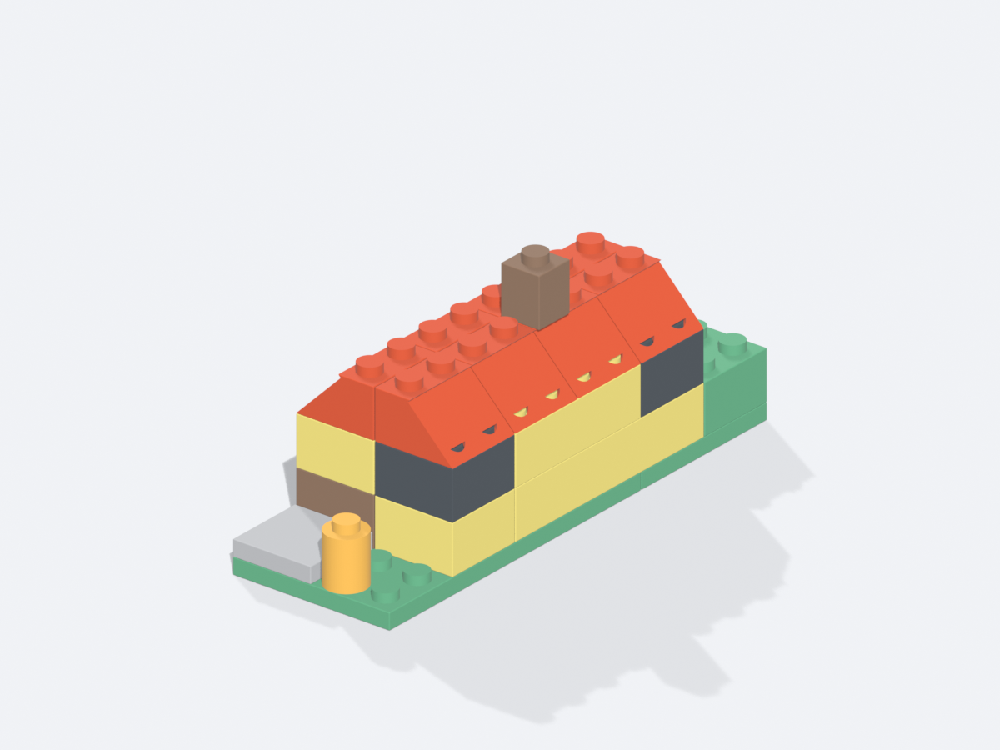

# brick-lab

Parametric **LEGO-compatible bricks** modelled in Blender, tuned for FDM printing,
plus example models and print-ready Bambu Studio projects.



- **27 brick types** on a true 8 mm stud pitch (bricks, slopes, rounds, plates, tiles)
- **Print-ready 3MF** — one Bambu Studio project per brick, with the user's printer,
  process and filament settings baked in
- **Clutch tuning from real prints** — press-fit 1x1 / 1x2 / 1x4, clearance-fit rounds,
  slopes and tiles
- **Example builds** with layer-by-layer instructions and per-colour print plates
- **Agent skills** that document the Blender → Bambu 3MF pipeline and the brick spec

## Examples

| Model | Bricks | Plates | |
|---|---|---|---|
| [Warship](examples/warship) | 26 | 3 |  |
| [Cottage](examples/cottage) | 24 | 7 |  |

Each example contains `design.py` (the model), `brickkit.py` (grid placement +
validation + renders), `BOM.md` (piece list) and `PRINT.md` (plate plan).
Assembly instructions are rendered as one image per layer — see
[`docs/images/warship_steps.png`](docs/images/warship_steps.png).

## Requirements

- **Blender 4.2+** (developed on 5.2.1; EEVEE only, no add-ons required)
- Optional: **Bambu Studio 2.x** for slicing and for the extra CLI validation step

## Quick start

```bash
# 0. edit paths in the commands below if your blender binary differs
BLENDER=blender

# 1. build the 27 bricks (writes bricks/bricks.blend + overview renders)
$BLENDER -b --factory-startup -P bricks/build_bricks.py

# 2. mechanical checks (clearance, press-fit, cavity sizes)
$BLENDER -b --factory-startup -P bricks/verify_assembly.py
$BLENDER -b --factory-startup -P tools/check_specs.py

# 3. export one Bambu Studio project per brick -> bricks/exports/*.3mf
$BLENDER -b --factory-startup -P bricks/export_bricks_3mf.py

# 4. rebuild the example models (renders, BOM, print plans, 3MF)
$BLENDER -b --factory-startup -P examples/warship/make_all.py
$BLENDER -b --factory-startup -P examples/cottage/make_all.py

# 5. cross-check bricks + both examples (mesh identity, BOM counts, 3MF parts)
$BLENDER -b --factory-startup -P tools/check_consistency.py
```

Generated files land next to their source: `bricks/exports/*.3mf` (committed),
`examples/*/warship_print.3mf`, renders and `.blend` scenes (ignored by git).

## Brick set

| Type | Footprint (mm) | Clutch |
|---|---|---|
| `brick_1x1` | 7.8 × 7.8 | 4.40 cavity (press-fit, no tubes) |
| `brick_1x2` | 7.8 × 15.8 | 4.45 cavity (press-fit, no tubes) |
| `brick_1x4` | 7.8 × 31.8 | 4.45 cavity (press-fit, no tubes) |
| `brick_2x2` | 15.8 × 15.8 | 4.80 clutch tubes |
| `brick_2x4` | 15.8 × 31.8 | 4.80 clutch tubes |
| `brick_2x6` | 15.8 × 47.8 | 4.80 clutch tubes |
| `slope_1x1_30` | 7.8 × 7.8 | 4.80 cavity (no top studs) |
| `slope_1x2_30` | 7.8 × 15.8 | 4.80 cavity (no top studs) |
| `slope_2x2_45` | 15.8 × 15.8 | 4.60 clutch tubes |
| `round_brick_1x1` | 7.8 × 7.8 | 4.65 bore |
| `round_brick_2x2` | 15.8 × 15.8 | 4 pockets, 4.60 × 1.9 deep |
| `round_plate_1x1` | 7.8 × 7.8 | 4.80 bore |
| `plate_1x1` | 7.8 × 7.8 | 4.80 cavity (no tubes) |
| `plate_1x2` | 7.8 × 15.8 | 4.80 cavity (no tubes) |
| `plate_1x4` | 7.8 × 31.8 | 4.80 cavity (no tubes) |
| `plate_2x2` | 15.8 × 15.8 | 4.80 clutch tubes |
| `plate_2x4` | 15.8 × 31.8 | 4.80 clutch tubes |
| `plate_2x6` | 15.8 × 47.8 | 4.80 clutch tubes |
| `plate_4x4` | 31.8 × 31.8 | 4.80 clutch tubes |
| `plate_4x8` | 31.8 × 63.8 | 4.80 clutch tubes |
| `plate_8x8` | 63.8 × 63.8 | 4.80 clutch tubes |
| `plate_6x12` | 47.8 × 95.8 | 4.80 clutch tubes |
| `tile_1x1` | 7.8 × 7.8 | 1 pocket, 4.60 × 1.9 deep |
| `tile_1x2` | 7.8 × 15.8 | 2 pockets, 4.60 × 1.9 deep |
| `tile_2x2` | 15.8 × 15.8 | 4 pockets, 4.60 × 1.9 deep |
| `tile_2x4` | 15.8 × 31.8 | 8 pockets, 4.60 × 1.9 deep |
| `jumper_1x2` | 7.8 × 15.8 | 4.80 cavity (one centred stud) |

Full machine-readable specs: [`bricks/bricks.json`](bricks/bricks.json).
Nominal stud OD is **4.5 mm** (4.8 socket minus 0.3 print clearance); heights are
9.6 mm (brick) and 3.2 mm (plate/tile).

## Printing

- 0.20 mm layer, PLA, textured PEI. All parts are single-piece, no supports.
- One plate per colour (single-extruder friendly). Plates are separated by ≥ 6 mm
  and kept 12 mm from the bed edge.
- `brick_1x1` / `brick_1x2` / `brick_1x4` are press-fit; round parts, slopes and
  tiles use nominal-zero / small-clearance fits that rely on FDM hole shrink for
  grip. Plates, the jumper and the cheese slopes use the standard 4.80 cavity.
  If your holes print oversized, tighten the cavity by ~0.05 mm (see
  `bricks.json` and the skill's tuning notes).

### Using a different printer

The shipped `bricks/bambu_template/` targets a **Bambu Lab P2S** (256 × 256 mm).
Replace it with a template exported from your own Bambu Studio project and set
`BED_SIZE` — see [`bricks/bambu_template/README.md`](bricks/bambu_template/README.md).

```bash
BED_SIZE=220 BAMBU_TEMPLATE=/path/to/template \
  $BLENDER -b --factory-startup -P bricks/export_bricks_3mf.py
```

## Repository layout

```
bricks/           generator, specs (bricks.json), template, 27 print-ready 3MFs
examples/warship  destroyer: design, BOM, print plan, instructions
examples/cottage  cottage:   design, BOM, print plan
tools/            spec + cross-project consistency checks
docs/images/      README renders
.opencode/skills/ agent skills (Blender→3MF pipeline, brick spec)
```

## Agent skills

Two skills in `.opencode/skills/` teach an agent how this project works. They are
plain `SKILL.md` folders (YAML front matter + markdown + optional references and
scripts), so they work with opencode out of the box and can be reused by other
agents that follow the same convention.

| Skill | Use it when… |
|---|---|
| **`blender-bambu-3mf`** | exporting Blender geometry to a print-ready Bambu Studio 3MF (single piece or multi-plate), rendering plate thumbnails, or debugging "empty plate", duplicate IDs and coplanar-boolean issues |
| **`blender-bricks-kit`** | looking up brick dimensions/clutch values, tuning a fit, or starting a new model on top of this brick set (grid/layer model, `brickkit` API, project scaffold) |

Each skill contains `SKILL.md` (workflow and rules), `references/` (format
details, pitfalls, brick tables) and — for the 3MF skill — a reusable
`scripts/printpack.py`.

### Installation

**Option 1 — use this repository as your workspace (recommended)**

```bash
git clone git@github.com:doombeaker/brick-lab.git
cd brick-lab
opencode          # skills are discovered from .opencode/skills/
```

**Option 2 — add the skills to an existing opencode workspace**

```bash
# project-level (only that workspace)
mkdir -p /path/to/workspace/.opencode/skills
cp -R /path/to/brick-lab/.opencode/skills/blender-* /path/to/workspace/.opencode/skills/

# or user-level (all workspaces)
mkdir -p ~/.config/opencode/skills
cp -R /path/to/brick-lab/.opencode/skills/blender-* ~/.config/opencode/skills/
```

Symlinks work too, but both skills reference paths inside this repository
(`bricks/`, `examples/`), so keep the clone around if you link instead of copy.
Skills are matched by their `description`, so restart the session if a newly
added skill does not show up.

**Option 3 — other agents**

The folders follow the common `SKILL.md` convention used by Claude Code and
similar tools: copy them into that tool's skill directory, e.g.
`.claude/skills/` (project) or `~/.claude/skills/` (user). For agents without a
skill loader, point the agent at `.opencode/skills/<name>/SKILL.md` directly.

### Usage

Ask in natural language; the agent loads the matching skill:

- "把 examples/cottage 导出成多盘 3MF" → `blender-bambu-3mf`
- "Bambu 打开后只有 1 号盘有零件，为什么？" → `blender-bambu-3mf`
- "基于现有积木做一个双层小屋" → `blender-bricks-kit`
- "2x6 板的尺寸是多少？/ tile 有点紧，帮我调一下" → `blender-bricks-kit`

Prerequisites for following the skills end to end: Blender 4.2+ (tested on 5.2)
and, for the optional CLI validation, Bambu Studio 2.x.

## License

- Code (scripts, skills): **MIT** — see [LICENSE](LICENSE).
- Brick models, renders and documentation: **CC BY 4.0**.

LEGO® is a trademark of the LEGO Group. This project is not affiliated with or
endorsed by the LEGO Group.
